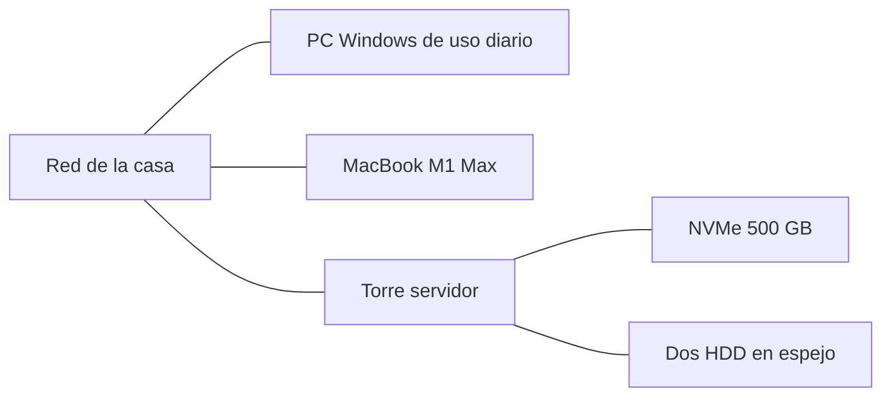

# Topología del homelab

Estado al lunes 23 de noviembre de 2026 (Ciudad de México). El switch todavía no se compra. Las VLAN y las direcciones se anotan aquí cuando el equipo esté en la mesa.

## Lo que hay hoy

| Nodo | Función ahora | Función prevista |
| --- | --- | --- |
| PC Windows | Uso diario y, desde esta fase, consola y SSH del laboratorio. | Sigue siendo el equipo de trabajo. No se formatea. |
| MacBook M1 Max | Disponible. | Consola de respaldo, con adaptador USB-C si el cable es USB-A. |
| Torre de escritorio | Equipo aparte de la PC Windows. | Proxmox VE, o Debian con Docker, sobre el NVMe. |
| NVMe 500 GB | Instalado o listo para la torre. | Sistema, máquinas virtuales y contenedores. |
| 2 HDD | Instalados o listos para la torre. | Espejo para datos. El arreglo se define en la bitácora el día de la instalación. |

Supuesto de este archivo: la PC Windows de uso diario y la torre del servidor son dos equipos. Si en realidad son la misma máquina, hay que decirlo antes de planear el formateo.

## Objetivo, todavía sin direcciones

Dos redes separadas en el switch, cuando exista:

- Red de la casa: lo que ya está (PC Windows, Mac, lo demás del hogar).
- Red del servidor: la torre y los servicios que publique.

El enlace entre las dos queda en el propio switch o en el router de la casa. El dibujo y los ID de VLAN se escriben en la primera sesión de consola, junto con el número de parte real del equipo que se haya comprado.
